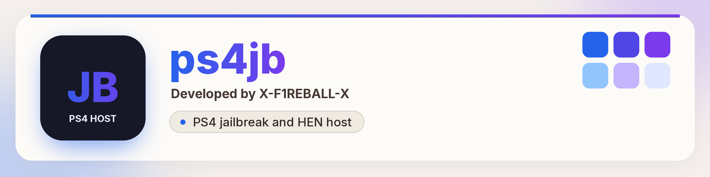

PS4 jailbreak and HEN host that runs in the PS4 browser.

## Quick start

1. Open https://x-f1reball-x.github.io/ps4jb/ in the PS4 Internet Browser and add it to Favorites.
2. Wait for `Cache ready`. The jailbreak then starts by itself.
3. If it fails, restart the console and try again.

Everything else is in the [guide](https://x-f1reball-x.github.io/ps4jb/docs/guide/).

## Contents

- [Features](#features)
- [Requirements](#requirements)
- [Installation](#installation)
- [Supported firmwares](#supported-firmwares)
- [Included chains and payloads](#included-chains-and-payloads)
- [What's new in 1.0.0](#whats-new-in-100)
- [License](#license)
- [Credits](#credits)

## Features

- Picks a jailbreak chain from your firmware. Override it with `?chain=` (`cssfontface`, `psfree`, `slopkit`, `relapse`).
- Firmware coverage 6.00–12.02 and 12.50–13.52. Proven on 13.02, 13.04, 13.50 and 13.52.
- Ships `hen.bin`, `goldhen.bin` and `ps4debug.bin`.

## Requirements

- A PS4 on a supported firmware (see the table below).
- The PS4 Internet Browser.
- Optional: the update-blocking DNS below.

## Installation

### 1. Block Sony updates (DNS)

Optional but recommended. DNS by **Nomadic**: blocks official system updates.

1. Settings → Network → Set Up Internet Connection
2. Choose **Custom** setup
3. DNS Settings: **Manual**
4. Primary DNS: `62.210.38.117`
5. Leave Secondary DNS empty
6. Save and test the connection (failing to reach Sony is OK)

### 2. Open the host in the PS4 browser

1. Open the PS4 Internet Browser
2. Clear Cookies and Clear Cache (Options menu)
3. Go to: https://x-f1reball-x.github.io/ps4jb/
4. Add the page to **Favorites**

### 3. Jailbreak

1. Open the favorite / link
2. Wait for cache (`Cache ready`), then the jailbreak starts
3. Wait for success (the page tries to close)
4. If it fails: restart the console and try again

The host picks a chain from your firmware. Override with `?chain=` if needed (`cssfontface`, `psfree`, `slopkit`, `relapse`).

## Supported firmwares

Coverage: **6.00–12.02** and **12.50–13.52**. Proven on **13.02 / 13.04 / 13.50 / 13.52**.

| Firmware | Chain | Status |
| --- | --- | --- |
| 13.02, 13.04, 13.50, 13.52 | Slopkit Relapse | Works |
| 12.50 - 13.00 | Slopkit Netctrl | Auto (untested here) |
| 11.03 - 12.02 | Slopkit Lapse | Auto (untested here) |
| 7.00 - 11.02 | CSSFontFace + Lapse | Auto (untested here) |
| 7.00 - 9.60 | PSFree + Lapse | `?chain=psfree` (untested) |
| 6.70 - 6.72 | BadHoist | Entry page (limited) |
| 6.00 - 6.69 | CSSFontFace + Lapse | Auto (untested here) |

## Included chains and payloads

**Chains** (under `chains/`):

- `relapse`: Slopkit Relapse (13.02–13.52)
- `slopkit`: Slopkit Lapse / Netctrl
- `cssfontface`: CSSFontFace + Lapse
- `psfree-lapse`: PSFree + Lapse
- `badhoist`: BadHoist (6.70–6.72)

**Payloads** (repo root):

- `hen.bin`
- `goldhen.bin`
- `ps4debug.bin`

Kernel patches live in `patches/`.

## What's new in 1.0.0

First release: the browser host for 6.00–12.02 and 12.50–13.52, proven on 13.02, 13.04, 13.50 and 13.52. See the [releases page](https://github.com/X-F1REBALL-X/ps4jb/releases).

## License

AGPL-3.0. See [LICENSE](LICENSE) and [NOTICE](NOTICE). The WebKitty chain license is in [`chains/LICENSE.WebKitty-AGPL-3.0`](chains/LICENSE.WebKitty-AGPL-3.0).

## Credits

- **Sleirsgoevy**: BadHoist (6.70–6.72)
- **TheFloW**: NetControl / poops base (Netctrl)
- **Nathan Fargo**: CSSFontFace
- **abc**: PSFree
- **SpecterDev** / **ChendoChap**: Lapse
- **jordyidk**: Slopkit
- **raw13g**: Relapse / 13.xx offsets
- **B4411M**: offsets and patches
- **SiSTR0**: GoldHEN / HEN
- **zecoxao**: firmware dumps
- **Yenyen**: offsets / research
- **EchoStretch**: hosts / tools
- **Nomadic**: update-blocking DNS

Developed by [X-F1REBALL-X](https://github.com/X-F1REBALL-X).
